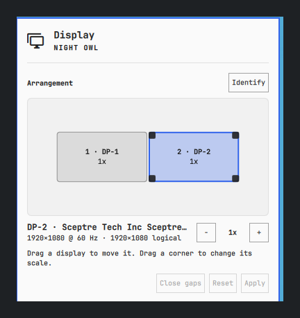

# Display Arrangement for Omarchy

Omarchy's built-in Display widget, plus a Windows-style **arrangement editor**
for multi-monitor setups.



## Why

Hyprland positions monitors in *logical* pixels. If one screen's scale
changes (for example with `Super + /` or `Super + Alt + /`), it shrinks or
grows in layout space, but the positions in `monitors.lua` stay the same. The
screens drift apart, and the pointer can no longer cross from one to the other.
This widget shows that gap and fixes it in a couple of clicks, without editing
config by hand.

## Features

Everything from the stock Display widget (brightness, text size, scale presets,
enable/disable displays) is still here. The **Arrangement** section adds:

- **Drag to arrange.** Drag a display's box to move it. On release it snaps
  flush to the nearest neighbour and lines up edges and centres, like Windows.
- **Drag a corner to rescale.** Each box has four corner handles. Dragging one
  steps through the scales your mode supports cleanly (1, 1.25, 1.5, 1.6, 2, …)
  while the opposite corner stays put. The −/+ buttons do the same in single
  steps.
- **Identify.** Shows a small numbered card in the middle of every screen for
  a few seconds (number, connector, model, resolution, scale). The same numbers
  appear on the canvas boxes, and the display selected on the canvas is
  highlighted on its card. The cards are click-through.
- **Gap and overlap detection.** A display the pointer can't reach gets a red
  outline and a message such as `DP-2 isn't touching another display (384 px
  gap)`. **Close gaps** pulls every display back into one connected,
  non-overlapping layout. **Apply** stays disabled while a problem remains.
- **Apply with auto-revert.** **Apply** changes the live layout through
  `hyprctl eval`. Unless you press **Keep** within 15 seconds, the previous
  layout comes back automatically, so a bad layout can't strand you.
- **Saved to your config.** **Keep** writes `position` and `scale` into the
  matching one-line `hl.monitor({ output = "…", … })` rules in
  `~/.config/hypr/monitors.lua`, keeping mode, transform and everything else on
  the line. Outputs without a rule get one after Omarchy's catch-all rule.
  `GDK_SCALE` follows the lowest scale, the same way Omarchy's scaling command
  sets it. The previous file is kept as `monitors.lua.layout-bak`. Rules written
  across several lines are never rewritten; they're reported instead.

Disabled and mirrored displays are left out of the arrangement.

## Install

```bash
omarchy plugin add https://github.com/RyanT-git/omarchy-display-arrangement --enable
# Swap it in for the stock Display widget, so there's only one on the bar:
omarchy plugin disable omarchy.monitor
```

The plugin declares `clonedFrom: omarchy.monitor`, so keybindings and IPC
calls aimed at the built-in Display widget (`omarchy-shell omarchy.monitor …`)
reach this one while it's enabled.

## Remove

```bash
omarchy plugin remove io.github.ryant-git.display-arrangement
omarchy plugin enable omarchy.monitor
```

Removing the plugin doesn't touch `monitors.lua`. Any layout you kept stays as
it is.

## Dependencies

Only things every Omarchy install already has:

- Hyprland with the Lua config (`hyprctl eval`, `hl.monitor`)
- `python3`, to save the layout (`persist-layout.py`, standard library only)

## Usage tips

- Click a box to select it. Its details and −/+ scale buttons appear under
  the canvas.
- The canvas zoom is frozen while you drag, so the box stays under the pointer.
- After Apply, keep the panel open and press **Keep**. If the panel closes, the
  layout still reverts when the countdown ends.
- IPC: `omarchy-shell omarchy.monitor identify` shows the identify cards, and
  `omarchy-shell omarchy.monitor state` includes an `arrangement` object.

## Development

```bash
node tests/layout.test.js            # arrangement geometry (Layout.js)
python3 -I tests/persist_layout_test.py   # monitors.lua writer, against a temp HOME
omarchy plugin validate .
```

`Layout.js` has no QML dependencies. Monitor names reach `hyprctl eval` only
after matching `^[A-Za-z0-9._-]{1,64}$`, and all other values are numbers. All
text from `hyprctl` is shown with `Text.PlainText`.

## License

MIT. See [LICENSE](LICENSE). Derived from Omarchy's Display widget, which is
MIT-licensed.
